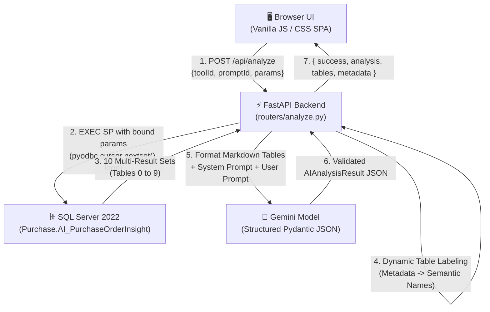
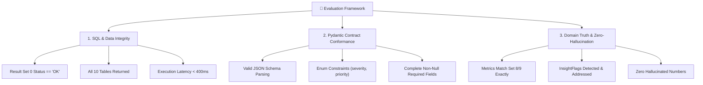

# Purchase Order Insight: Architecture Flow, LLM Pipeline & Evaluation Guide

This document provides a complete technical reference for the current stage of the **Analyzer POC** project, detailing the lifecycle intelligence flow for stored procedure `[Purchase].[AI_PurchaseOrderInsight]`, the exact data passed to the LLM, the evaluation criteria, input sources, test matrices, and analytical prompts.

---

## 1. Current Project Architecture Flow

The system operates as an **Enterprise AI SQL Data Analyzer**. It connects a lightweight browser UI with a FastAPI Python backend, queries live MS SQL Server stored procedures returning multiple result sets, formats tabular data, and transmits it to Google Gemini for structured JSON audit reasoning.



### End-to-End Processing Steps:
1. **Tool & Prompt Selection:** The user selects **PO Analyzer** (`po_analyzer`) in the UI, enters PO parameters (`PONo` or `PONoYearly`), and picks one of 4 analytical prompts.
2. **Parameter Resolution ([`routers/analyze.py`](file:///G:/AITests/Analyzer_POC/routers/analyze.py)):** Combines defaults and user parameters, building `EXEC [Purchase].[AI_PurchaseOrderInsight] @PONo = ?, @PONoYearly = ?, @CompanyNo = ?`.
3. **Multi-Resultset Execution ([`db/sql_client.py`](file:///G:/AITests/Analyzer_POC/db/sql_client.py)):** Uses `pyodbc` to execute the query and iterates through all 10 result sets via `cursor.nextset()`.
4. **Dynamic Metadata Enrichment:** The backend inspects Result Set 0 (`Metadata`) rows where `Section = 'RESULT_SET'` to automatically name each table (`POHeader`, `POItem`, `GateEntry`, `Receipt`, `PurchaseBill`, `ItemQtySummary`, `POSummary`).
5. **Token-Efficient Prompt Formatting ([`ai/gemini_client.py`](file:///G:/AITests/Analyzer_POC/ai/gemini_client.py)):** Converts tabular data to clean Markdown tables. If a table exceeds 500 rows, it computes aggregate statistical summaries (sum, avg, min, max).
6. **Gemini Structured Inference:** Calls Gemini with `response_mime_type="application/json"` and Pydantic schema [`AIAnalysisResult`](file:///G:/AITests/Analyzer_POC/models/schemas.py).
7. **Unified Response:** Returns both the structured AI insights (`executive_summary`, `key_metrics`, `findings`, `recommendations`) and raw SQL tables for side-by-side inspection.

---

## 2. Stored Procedure: `[Purchase].[AI_PurchaseOrderInsight]`

* **Location:** [`Procedures/Purchase.AI_PurchaseOrderInsight.sql`](file:///G:/AITests/Analyzer_POC/Procedures/Purchase.AI_PurchaseOrderInsight.sql)
* **Author / Date:** Alok (15/10/2026)
* **Database:** `SpectrumERP`
* **Execution Time:** ~200–350 ms against SQL Server 2022
* **Design Philosophy:** Self-describing and fixed-shape. Result Set 0 contains the metadata, schema definitions, and business rules, enabling the LLM to interpret subsequent tables without external documentation.

### Future Modification Resilience
When the stored procedure is modified in the future (e.g. adding columns or updating business rules):
* **No Code Breaking:** [`sql_client.py`](file:///G:/AITests/Analyzer_POC/db/sql_client.py) dynamically reads `cursor.description` for column names and row types.
* **Automatic Table Renaming:** [`routers/analyze.py`](file:///G:/AITests/Analyzer_POC/routers/analyze.py#L109-L128) parses Result Set 0 dynamically.
* **LLM Ingests the Updated Schema Automatically:** The LLM reads the Markdown output directly, meaning schema updates require zero prompt or pipeline rewrites.

---

## 3. What We Check (The 10 Result Sets)

| Set # | Table Name | Key Checked Elements |
|:---:|---|---|
| **0** | **Metadata** | Execution status (`OK`, `PO_NOT_FOUND`, `AMBIGUOUS_PO`), business rules, parameter mappings. |
| **1** | **POHeader** | Vendor name/location, department, validity status (`Active`/`Expired`), amendment history, authorization, PO age in days. |
| **2** | **POItem** | Ordered items, item codes, UOM, ordered quantity, unit rates, discounts, agreed delivery schedule dates (`MinScheduleDate`, `MaxScheduleDate`), and tolerance. |
| **3** | **POItemTax** | Item-level taxes (CGST, SGST, IGST), trade discounts, freight charges, calculation nature (`Add`/`Deduct`). |
| **4** | **POTaxSummary** | PO-level tax totals grouped by GST sequence (`Before GST`, `GST`, `After GST`). |
| **5** | **GateEntry** | Physical material arrival at factory gate (Challan Qty, Vehicle No, Transporter, Gate Entry Date, Days Gate-to-Receipt, Pending at Gate Qty). |
| **6** | **Receipt** | Material receipt inspection (GRN, Sub-contract BOQ GRN, Discrete RM SIN). Challan Qty, Received Qty, Accepted Qty, and **Rejected Qty**. |
| **7** | **PurchaseBill** | Invoices booked by Accounts Payable: Billed Qty, Bill Net Amount, Bill Date, Payment Mode, and **Outstanding Payable Amount**. |
| **8** | **ItemQtySummary** | **Line-level quantity reconciliation:** `POQty` → `GateEntryQty` → `GRNAcceptedQty` → `BilledQty` → `PendingBillingQty` → `POBalanceQty`, Schedule Delay Days, and **Pre-computed `InsightFlags`**. |
| **9** | **POSummary** | **Executive roll-up:** `OverallStatus` (`COMPLETED`, `PARTIALLY_RECEIVED`, `NOT_STARTED`, `CANCELLED`), Value Fulfillment %, Days Lead Time, Total Rejection Qty, Total Outstanding, and **Executive `InsightFlags`**. |

---

## 4. End-to-End Transmission Example (From Start to End)

### Step 1: User Request
```json
{
  "toolId": "po_analyzer",
  "promptId": "po_lifecycle_health_audit",
  "params": {
    "PONo": 1644,
    "CompanyNo": 4
  }
}
```

### Step 2: Query Execution on SQL Server
```sql
EXEC [Purchase].[AI_PurchaseOrderInsight] @PONo = 1644, @CompanyNo = 4
```

### Step 3: Exact Context Formatted and Sent to Gemini

#### A. System Prompt
```
You are a senior procurement director and enterprise audit specialist. Analyze the 10 lifecycle result sets returned by the PO insight stored procedure (POHeader, POItem, GateEntry, Receipt, PurchaseBill, ItemQtySummary, POSummary). Pay close attention to pre-computed InsightFlags and quantity reconciliation. Output strictly according to the requested JSON schema.
```

#### B. User Prompt Template with Injected Tabular Data
````markdown
Conduct a comprehensive health and fulfillment audit on the Purchase Order data below. Identify operational bottlenecks, evaluate completion status, and summarize key risks:

### Result Table: Metadata (51 total rows)
| SeqNo | Section | ResultSetNo | Name | Grain | KeyColumns | Description |
| --- | --- | --- | --- | --- | --- | --- |
| 1 | SP_INFO | | Purchase.AIPOInsight | | | Complete life-cycle of one Purchase Order (PO)... |
| 2 | EXECUTION | | Status | | | OK |
| 3 | EXECUTION | | StatusMessage | | | PO found. |
| 4 | EXECUTION | | ResolvedPONo | | | 1644 |

### Result Table: POHeader (1 total rows)
| PONo | PONoYearly | PODate | CompanyNo | CompanyName | DivisionName | Department | PODocumentType | VendorName | NetAmount | IsAuthorized | LatestAmendmentNo | POAgeDays |
| --- | --- | --- | --- | --- | --- | --- | --- | --- | --- | --- | --- | --- |
| 1644 | 0090/22-23 | 2022-11-01 | 4 | Force Intellect Pvt Ltd. | PLANT | ELECTRICAL | PO | A.B.C.D Technologies Pvt. Ltd. | 708000.00 | Yes | 1 | 1444 |

### Result Table: POItem (1 total rows)
| POItemDetailNo | ItemNo | ItemCode | ItemDescription | UOM | POQty | Rate | DiscountAmount | RateAfterDiscount | BasicValueAfterDiscount | NetAmount | MinScheduleDate | MaxScheduleDate | QtyBasisForBalance |
| --- | --- | --- | --- | --- | --- | --- | --- | --- | --- | --- | --- | --- | --- |
| 4211 | 5091 | 0125010048 | 1 LTR CANE EN8D | NOS | 12000.000 | 50.0000 | 0.00 | 50.0000 | 600000.00 | 708000.00 | 2022-11-01 | 2022-12-10 | Accepted |

### Result Table: POItemTax (2 total rows)
| ItemNo | ChargeName | TaxGroupCode | ChargeType | Nature | ChargeValue | TotalAmount | CalculationEffect |
| --- | --- | --- | --- | --- | --- | --- | --- |
| 5091 | CGST | CGST | (Exc.) | (%) | 9.00 | 54000.00 | Add |
| 5091 | SGST | SGST | (Exc.) | (%) | 9.00 | 54000.00 | Add |

### Result Table: POTaxSummary (2 total rows)
| ChargeName | TaxGroupName | ChargeOn | TotalAmount | GSTSequence |
| --- | --- | --- | --- | --- |
| CGST | CGST | On Item | 54000.00 | GST |
| SGST | SGST | On Item | 54000.00 | GST |

### Result Table: GateEntry (0 total rows)
_Empty result set (0 rows)._

### Result Table: Receipt (1 total rows)
| FlowType | ReceiptNo | ReceiptNoYearly | ReceiptDate | SourceDocument | VendorBillNo | VendorBillDate | ReceivedItemDescription | ChallanQty | ReceivedQty | AcceptedQty | RejectedQty | IsBilled |
| --- | --- | --- | --- | --- | --- | --- | --- | --- | --- | --- | --- | --- |
| GRN | 1817 | GRN\Process\0002\01.11.22 | 2022-11-01 | Purchase Order | 2457 | 2022-11-01 | 1 LTR CANE EN8D | 12000.000 | 12000.000 | 12000.000 | 0.000 | No |

### Result Table: PurchaseBill (0 total rows)
_Empty result set (0 rows)._

### Result Table: ItemQtySummary (1 total rows)
| POItemDetailNo | ItemCode | ItemDescription | UOM | POQty | GateEntryQty | PendingGRNAtGateQty | GRNAcceptedQty | GRNRejectedQty | BilledQty | PendingBillingQty | POBalanceQty | ReceiptFulfilmentPct | RejectionPct | InsightFlags |
| --- | --- | --- | --- | --- | --- | --- | --- | --- | --- | --- | --- | --- | --- | --- |
| 4211 | 0125010048 | 1 LTR CANE EN8D | NOS | 12000.000 | 0.000 | 0.000 | 12000.000 | 0.000 | 0.000 | 12000.000 | 0.000 | 100.00 | 0.00 | FULLY_RECEIVED,PENDING_BILLING |

### Result Table: POSummary (1 total rows)
| PONo | PONoYearly | VendorName | OverallStatus | TotalPOQty | TotalGRNAcceptedQty | TotalGRNRejectedQty | TotalBilledQty | TotalPendingBillingQty | TotalPOBalanceQty | POBasicValue | PONetAmount | AcceptedValue | ValueFulfilmentPct | InsightFlags |
| --- | --- | --- | --- | --- | --- | --- | --- | --- | --- | --- | --- | --- | --- | --- |
| 1644 | 0090/22-23 | A.B.C.D Technologies Pvt. Ltd. | COMPLETED | 12000.000 | 12000.000 | 0.000 | 0.000 | 12000.000 | 0.000 | 600000.00 | 708000.00 | 600000.00 | 100.00 | PENDING_BILLING,AMENDED |

[Execution Metadata]: Stored Procedure '[Purchase].[AI_PurchaseOrderInsight]' returned 10 table(s) with 59 total row(s).
````

### Step 4: Structured Output Generated by Gemini
```json
{
  "executive_summary": "Purchase Order 0090/22-23 (Internal PONo: 1644) for vendor A.B.C.D Technologies Pvt. Ltd. is 100% fulfilled in terms of physical delivery with 12,000 units of '1 LTR CANE EN8D' accepted at GRN without rejections. However, a severe financial bottleneck exists: all 12,000 units (value ₹6,00,000 basic / ₹7,08,000 net) remain unbilled by Accounts Payable despite 1,444 days elapsed since material receipt.",
  "key_metrics": [
    { "label": "PO Value (Net)", "value": "₹7,08,000", "trend": "Authorized" },
    { "label": "Ordered Quantity", "value": "12,000 NOS", "trend": "100% Fulfilled" },
    { "label": "Pending Billing Qty", "value": "12,000 NOS", "trend": "100% Unbilled" },
    { "label": "Quality Rejection Rate", "value": "0.0%", "trend": "Zero defects" }
  ],
  "findings": [
    {
      "title": "Severe Unbilled Inventory (Pending Billing)",
      "description": "GRN (No: 1817) accepted 12,000 units on 2022-11-01, referencing Vendor Bill No 2457. However, zero purchase bills are recorded in the finance ledger, leaving ₹7.08L unbooked.",
      "severity": "critical"
    },
    {
      "title": "Clean Material Delivery",
      "description": "Full order was delivered and accepted on the scheduled date with zero quality rejections.",
      "severity": "info"
    }
  ],
  "recommendations": [
    {
      "action": "Finance AP Investigation on Vendor Bill #2457",
      "expected_impact": "Prevents unrecorded inventory liabilities and supplier payment disputes.",
      "priority": "high"
    }
  ],
  "additional_notes": "PO has undergone 1 amendment; original delivery was received without an initial gate entry record (direct GRN flow)."
}
```

---

## 5. Evaluation Methodology

Evaluation occurs across three separate dimensions:



1. **SQL & Data Layer Evaluation:**
   * **Execution Status:** Result Set 0 must report `Status = 'OK'`. If `PO_NOT_FOUND` or `AMBIGUOUS_PO`, the pipeline must return graceful warnings without crashing.
   * **Table Count:** Must capture all 10 result sets.
   * **Performance Benchmark:** Stored procedure execution latency must remain under 400 ms.
2. **Schema & Contract Conformance Evaluation:**
   * Strict adherence to Pydantic model [`AIAnalysisResult`](file:///G:/AITests/Analyzer_POC/models/schemas.py).
   * Verified non-empty `executive_summary`.
   * Severity values constrained to `['info', 'warning', 'critical']`.
   * Priority values constrained to `['high', 'medium', 'low']`.
3. **Domain Groundedness (Zero-Hallucination Evaluation):**
   * **Mathematical Truth:** Totals mentioned in `key_metrics` (e.g., Total PO Qty, Accepted Qty, Balance Qty, Pending Billing Qty, Net Value) must match the pre-computed figures in Result Sets 8 and 9.
   * **Flag Concordance:** If Result Set 9 contains flags (`PENDING_BILLING`, `HAS_REJECTION`, `HAS_OVERDUE_ITEMS`), the AI must generate a corresponding `critical` or `warning` finding.

---

## 6. SP Inputs & Data Sources

### Input Parameters
| Parameter | Type | Required? | Default | Description |
|---|---|---|---|---|
| `@PONo` | `int` | Optional* | `1644` | Internal primary key (`Purchase.POMain.PONo`). Takes precedence. |
| `@PONoYearly` | `varchar(50)` | Optional* | `NULL` | Document number visible to ERP users (e.g. `'0090/22-23'`). |
| `@CompanyNo` | `tinyint` | Optional | `4` | Company ID filter (required if `@PONoYearly` is shared across companies). |

*\*Note: Either `@PONo` OR `@PONoYearly` must be provided.*

### Where Inputs are Sourced:
1. **User Interface ([`public/index.html`](file:///G:/AITests/Analyzer_POC/public/index.html)):** Generated dynamically from the configuration in [`config/tools.json`](file:///G:/AITests/Analyzer_POC/config/tools.json#L130-L155).
2. **Database Sourcing:** Looked up from `Purchase.POMain` (`PONo`, `DocumentNoYearly`, `CompanyNo`).

---

## 7. Test Matrix: Inputs to Test

A standard suite of **6 distinct test scenarios** covers the full operational lifecycle:

| Test ID | Scenario | Input Arguments | What We Verify |
|:---:|---|---|---|
| **TC-01** | **Completed & Fully Billed PO** | `@PONo = 3341, @CompanyNo = 4` | 3 items, 100% accepted, 3 purchase bills booked, balance = 0, status `COMPLETED`. |
| **TC-02** | **Received but Unbilled PO** | `@PONo = 1644, @CompanyNo = 4` | 12,000 units accepted at GRN, 0 purchase bills booked. Verifies detection of `PENDING_BILLING` and `AMENDED`. |
| **TC-03** | **Open / Newly Created PO** | `@PONo = 3340, @CompanyNo = 4` | 0 Gate Entry, 0 GRN. Verifies `NOT_STARTED` overall status and open balance calculations. |
| **TC-04** | **Document Number Resolution** | `@PONoYearly = '0090/22-23', @CompanyNo = 4` | Verifies resolution of internal PO key when user queries via document number. |
| **TC-05** | **Non-Existent PO (Zero Data)** | `@PONo = 9999999` | Verifies Result Set 0 returns `PO_NOT_FOUND` and all 10 tables return 0 rows cleanly without crashing. |
| **TC-06** | **Ambiguous Yearly Document No** | `@PONoYearly = 'Div02/0002', @CompanyNo = NULL` | Verifies Result Set 0 returns `AMBIGUOUS_PO` when duplicate document numbers exist across companies. |

---

## 8. Configured AI Prompts for PO Analysis

Located in [`config/tools.json`](file:///G:/AITests/Analyzer_POC/config/tools.json#L156-L185), 4 specialized prompts are available:

### 1. `po_lifecycle_health_audit` (Comprehensive PO Health & Lifecycle Audit)
* **System Prompt:**
  ```text
  You are a senior procurement director and enterprise audit specialist. Analyze the 10 lifecycle result sets returned by the PO insight stored procedure (POHeader, POItem, GateEntry, Receipt, PurchaseBill, ItemQtySummary, POSummary). Pay close attention to pre-computed InsightFlags and quantity reconciliation. Output strictly according to the requested JSON schema.
  ```
* **User Prompt Template:**
  ```text
  Conduct a comprehensive health and fulfillment audit on the Purchase Order data below. Identify operational bottlenecks, evaluate completion status, and summarize key risks:

  {{data}}
  ```

### 2. `vendor_delivery_performance` (Vendor Delivery Lead Time & Delay Audit)
* **System Prompt:**
  ```text
  You are a supply chain operations expert specializing in vendor SLA tracking, lead time variance, and delivery delay analysis. Evaluate schedule dates against gate entry and receipt timestamps. Output strictly according to the requested JSON schema.
  ```
* **User Prompt Template:**
  ```text
  Analyze supplier delivery timeliness and lead time performance from the PO lifecycle data below. Highlight delayed items, compute schedule variance, and evaluate vendor reliability:

  {{data}}
  ```

### 3. `quality_rejection_audit` (Quality Inspection & Material Rejection Analysis)
* **System Prompt:**
  ```text
  You are a quality assurance director and vendor quality engineer. Analyze material receipts, inspection outcomes, and rejection percentages across all items. Output strictly according to the requested JSON schema.
  ```
* **User Prompt Template:**
  ```text
  Audit material quality and inspection results in the PO data below. Highlight items with rejections, calculate rejection rates, and recommend supplier corrective actions:

  {{data}}
  ```

### 4. `three_way_matching_finance` (Three-Way Match & Accounts Payable Reconciliation)
* **System Prompt:**
  ```text
  You are a corporate controller and accounts payable auditor. Perform a 3-way match reconciliation between the Purchase Order, Goods Receipt (GRN), and Purchase Bills. Flag unbilled inventory and outstanding liabilities. Output strictly according to the requested JSON schema.
  ```
* **User Prompt Template:**
  ```text
  Perform a 3-way match financial audit on the PO dataset below. Identify any unbilled receipts (PendingBillingQty), compare billed amounts against PO commitments, and review outstanding payables:

  {{data}}
  ```
