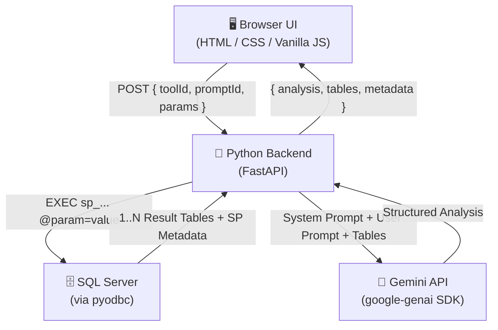

# Analyzer POC – Revised Architecture Plan (Python Backend)

## What We're Building
A **multi-tool AI-powered SQL data analyzer**. Users pick a tool (**PO Analyzer / Sales Analyzer / Indent Analyzer**), enter input parameters, select a prompt, and receive a structured AI analysis — powered by data retrieved from SQL Server stored procedures.

---

## Revised Architecture



---

## User Journey

```
1. Select Tool         →  PO Analyzer | Sales Analyzer | Indent Analyzer
2. Enter Parameters    →  Dynamic form fields rendered per tool
3. Select Prompt       →  Scrollable list of AI analysis prompts for that tool
4. Submit              →  Single "Analyze" button
5. View Results        →  AI analysis + raw SQL result tables
```

---

## Tech Stack

| Layer | Technology | Reason |
|---|---|---|
| **Frontend** | HTML + Vanilla CSS + Vanilla JS | No build step, fast for POC |
| **Backend** | Python 3.11 + FastAPI | Fast, async, auto-docs at `/docs` |
| **SQL Driver** | `pyodbc` + ODBC Driver 17/18 for SQL Server | Standard Windows SQL Server connectivity |
| **AI SDK** | `google-genai` (Python) | Official Gemini SDK |
| **Config** | `tools.json` for tool/prompt/SP defs, `.env` for secrets |
| **ASGI Server** | `uvicorn` | FastAPI's recommended server |

---

## Project File Structure

```
Analyzer_POC/
│
├── .env                          # Secrets (SQL + Gemini)
├── .env.example                  # Template
├── requirements.txt              # Python dependencies
├── main.py                       # FastAPI app entry point
│
├── config/
│   └── tools.json                # ALL tool/prompt/SP definitions
│
├── db/
│   └── sql_client.py             # pyodbc connection + SP executor
│                                 # → returns List[Table] + SP metadata
│
├── ai/
│   └── gemini_client.py          # Prompt builder + Gemini API call
│
├── routers/
│   └── analyze.py                # POST /api/analyze route
│
├── models/
│   └── schemas.py                # Pydantic request/response models
│
└── public/                       # Static frontend (served by FastAPI)
    ├── index.html
    ├── styles.css
    └── app.js
```

---

## Data Flow — Detailed

### Step 1: SP Execution (`db/sql_client.py`)
```
Input:  storedProcedure="sp_AnalyzeSales", params={"StartDate": "2024-01-01"}
Output:
  tables: [
    { "name": "ResultSet_1", "columns": [...], "rows": [[...], [...]] },
    { "name": "ResultSet_2", "columns": [...], "rows": [[...]] }
  ]
  metadata: {
    "sp_name": "sp_AnalyzeSales",
    "execution_time_ms": 342,
    "total_rows": 54,
    "table_count": 2
  }
```
- Uses `pyodbc` cursor — iterates `nextset()` to capture **all result sets**
- Also captures SP metadata: execution time, row counts per table

### Step 2: Prompt Construction (`ai/gemini_client.py`)
```
System Prompt  =  tools.json → prompt.systemPrompt
                  (defines AI role, output format, tone)

User Prompt    =  tools.json → prompt.userPromptTemplate
                  with {{data}} replaced by formatted tables

Final Message  =  System Prompt
                  + "--- DATA ---"
                  + Table 1 (markdown table format)
                  + Table 2 (if multiple)
                  + SP Metadata summary
                  + User Prompt instructions
```

### Step 3: AI Response → Frontend
```
AI returns structured JSON:
{
  "summary": "...",
  "findings": ["...", "..."],
  "recommendations": ["...", "..."],
  "risk_flags": ["..."]          ← optional, per prompt config
}
```
Frontend renders each section with its own visual style.

---

## `tools.json` Schema

```json
{
  "tools": [
    {
      "id": "sales_analyzer",
      "label": "Sales Analyzer",
      "icon": "📊",
      "accentColor": "#FF6B6B",
      "description": "AI-powered analysis of sales trends, top performers, and forecasts",
      "params": [
        { "name": "StartDate", "label": "Start Date", "type": "date", "required": true },
        { "name": "EndDate",   "label": "End Date",   "type": "date", "required": true }
      ],
      "prompts": [
        {
          "id": "top_products",
          "label": "Top Products by Revenue",
          "storedProcedure": "sp_GetTopProducts",
          "systemPrompt": "You are an expert sales analyst. Your job is to identify revenue trends, top-performing products, and actionable recommendations from the provided sales data. Always respond in valid JSON.",
          "userPromptTemplate": "Analyze the sales data below. Identify the top performers, trends, and provide 3-5 actionable recommendations.\n\n{{data}}",
          "outputSections": ["summary", "findings", "recommendations"]
        },
        {
          "id": "monthly_trend",
          "label": "Monthly Sales Trend",
          "storedProcedure": "sp_GetMonthlySales",
          "systemPrompt": "You are a sales performance analyst specializing in trend detection and forecasting.",
          "userPromptTemplate": "Review the monthly sales data below. Identify growth/decline patterns and forecast the next quarter.\n\n{{data}}",
          "outputSections": ["summary", "findings", "forecast"]
        }
      ]
    },
    {
      "id": "po_analyzer",
      "label": "PO Analyzer",
      "icon": "📋",
      "accentColor": "#6C63FF",
      "description": "Analyzes purchase orders for anomalies, delays, and compliance",
      "params": [
        { "name": "PONumber", "label": "PO Number", "type": "text", "required": false },
        { "name": "DateFrom", "label": "From Date", "type": "date", "required": true }
      ],
      "prompts": []
    },
    {
      "id": "indent_analyzer",
      "label": "Indent Analyzer",
      "icon": "🔍",
      "accentColor": "#00D2FF",
      "description": "Reviews indents for approval status, aging, and fulfillment gaps",
      "params": [
        { "name": "IndentId", "label": "Indent ID", "type": "text", "required": false }
      ],
      "prompts": []
    }
  ]
}
```

---

## API Endpoints

### `GET /api/tools`
Returns the full `tools.json` — frontend uses this to build all UI dynamically.

### `POST /api/analyze`
**Request:**
```json
{
  "toolId": "sales_analyzer",
  "promptId": "top_products",
  "params": { "StartDate": "2024-01-01", "EndDate": "2024-12-31" }
}
```

**Response (200 OK):**
```json
{
  "success": true,
  "analysis": {
    "summary": "Sales grew 18% YoY driven by Widget A and Widget B...",
    "findings": ["Widget A leads with ₹52L revenue", "Q3 shows consistent dip"],
    "recommendations": ["Increase Widget A inventory by 20%", "Run Q3 promotions"]
  },
  "tables": [
    {
      "name": "Top Products",
      "columns": ["Product", "Revenue", "Units"],
      "rows": [["Widget A", 5200000, 1040], ["Widget B", 3100000, 620]]
    }
  ],
  "metadata": {
    "sp_name": "sp_GetTopProducts",
    "execution_time_ms": 284,
    "table_count": 1,
    "total_rows": 10,
    "model": "gemini-2.5-flash"
  }
}
```

**Response (Error):**
```json
{
  "success": false,
  "error": "SQL execution failed",
  "detail": "Stored procedure 'sp_GetTopProducts' not found in database"
}
```

---

## UI Layout

### Screen 1 – Tool Hub
```
╔══════════════════════════════════════════════════════╗
║  🔬  ANALYZER POC                      [header bar] ║
╠══════════════════════════════════════════════════════╣
║                                                      ║
║   ┌───────────────┐  ┌───────────────┐  ┌─────────┐ ║
║   │  📊 Sales     │  │  📋 PO        │  │  🔍     │ ║
║   │  Analyzer     │  │  Analyzer     │  │ Indent  │ ║
║   │               │  │               │  │Analyzer │ ║
║   │  [Open →]     │  │  [Open →]     │  │[Open →] │ ║
║   └───────────────┘  └───────────────┘  └─────────┘ ║
╚══════════════════════════════════════════════════════╝
```

### Screen 2 – Tool Workspace (3-panel)
```
╔══════════════════════════════════════════════════════╗
║  ← Back  |  📊 Sales Analyzer                        ║
╠══════════════╦═══════════════════╦═══════════════════╣
║  PROMPTS     ║  PARAMETERS       ║  RESULTS          ║
║  ──────────  ║  ───────────────  ║  ───────────────  ║
║  ○ Top Prods ║  Start Date       ║  [AI Summary      ║
║  ● Monthly   ║  [────────────]   ║   card renders    ║
║  ○ Forecast  ║                   ║   here]           ║
║              ║  End Date         ║                   ║
║              ║  [────────────]   ║  [Findings]       ║
║              ║                   ║  [Recommendations]║
║              ║  [▶ ANALYZE]      ║  ─────────────    ║
║              ║                   ║  ▼ Raw SQL Tables  ║
╚══════════════╩═══════════════════╩═══════════════════╝
```

---

## Python Backend — Key Implementation Notes

### `db/sql_client.py` — Multi-ResultSet Capture
```python
# Captures ALL result sets from a single SP execution
tables = []
if cursor.description:
    tables.append(extract_table(cursor))
while cursor.nextset():
    if cursor.description:
        tables.append(extract_table(cursor))
```

### `ai/gemini_client.py` — Prompt Construction
```python
# Converts tables to markdown for AI context
def tables_to_markdown(tables: list[dict]) -> str:
    ...

# Final prompt = system + formatted data + user template
full_prompt = f"{system_prompt}\n\n--- DATA ---\n{tables_md}\n\n--- TASK ---\n{user_prompt}"
```

### Pydantic Models (`models/schemas.py`)
```python
class AnalyzeRequest(BaseModel):
    toolId: str
    promptId: str
    params: dict[str, Any]

class AnalyzeResponse(BaseModel):
    success: bool
    analysis: dict | None
    tables: list[dict] | None
    metadata: dict | None
    error: str | None
```

---

## Environment Variables

```env
# SQL Server
SQL_SERVER=your_server_name
SQL_DATABASE=your_database
SQL_USER=your_sql_user
SQL_PASSWORD=your_sql_password
SQL_PORT=1433
SQL_DRIVER=ODBC Driver 17 for SQL Server

# Gemini
GEMINI_API_KEY=your_gemini_api_key
GEMINI_MODEL=gemini-2.5-flash

# App
PORT=8000
```

---

## Implementation Phases

### Phase 1 — Python Backend
- [ ] `requirements.txt`
- [ ] `.env.example`
- [ ] `config/tools.json` (3 tools, prompts = placeholders for now)
- [ ] `models/schemas.py` (Pydantic models)
- [ ] `db/sql_client.py` (pyodbc, multi-resultset, metadata)
- [ ] `ai/gemini_client.py` (prompt builder, Gemini call, parse JSON response)
- [ ] `routers/analyze.py` (orchestrate SP → AI → response)
- [ ] `main.py` (FastAPI app, static files, CORS, routes)

### Phase 2 — Frontend
- [ ] `public/index.html` (SPA shell, semantic HTML)
- [ ] `public/styles.css` (dark glassmorphism system, 3-panel layout)
- [ ] `public/app.js` (loads tools from API, renders workspace, handles results)

### Phase 3 — Polish
- [ ] Loading skeleton screens
- [ ] Error messages (SQL error, AI error, validation)
- [ ] Collapsible raw SQL result tables
- [ ] Copy-to-clipboard on analysis
- [ ] `README.md` (setup, run, how to add new tools/prompts)

---

## Open items before building
- ✅ Backend: **Python + FastAPI**
- ✅ SQL Auth: **SQL Server Authentication** (`.env`)
- ✅ SPs: **Provided later** — backend calls whatever is in `tools.json`
- ✅ Tools: **PO Analyzer, Sales Analyzer, Indent Analyzer**
- ⬜ **Gemini model**: `gemini-2.5-flash` (recommended) or your preference?
- ⬜ **ODBC Driver version**: 17 or 18 installed on your machine?
